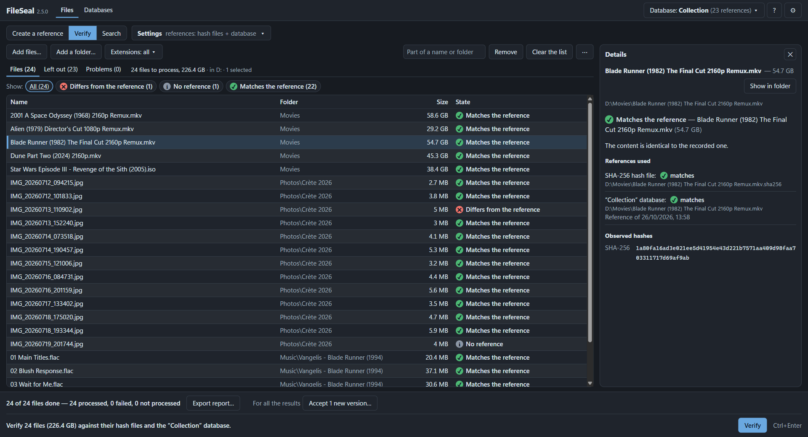
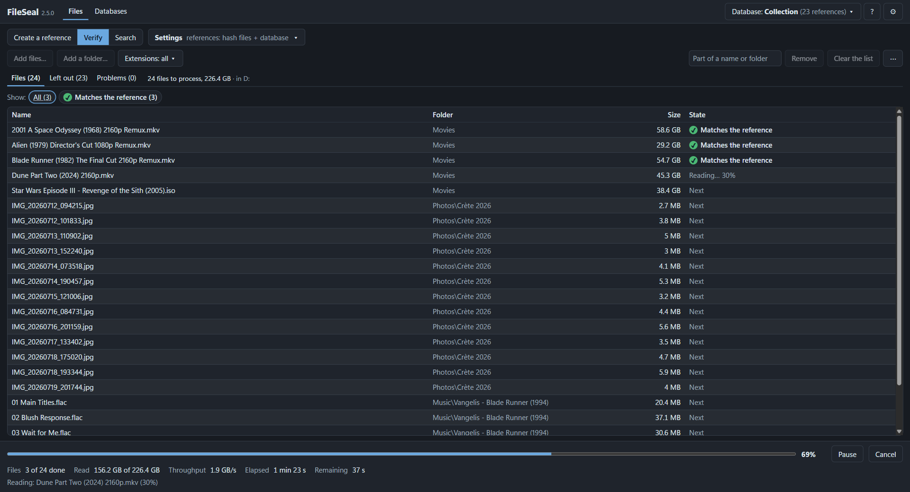
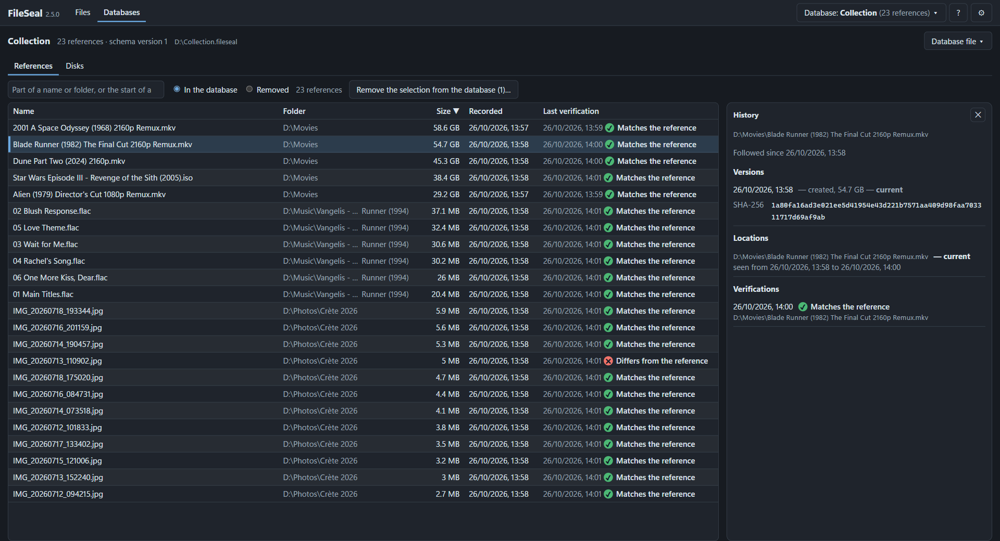

# FileSeal

**Know when your files change.**

FileSeal is a Windows app that keeps a fingerprint of your files and tells you, months or years later, whether they are still exactly the same. Use it for movie and photo collections, archives, backups and external drives: anything you want to keep intact over time.

**[Download the latest version](https://github.com/Nikola-Putnik/FileSeal2/releases/latest)**: Windows, 64-bit, free and open source. Works offline, with no account.



## How it works

Take a file you care about:

```
D:\Movies\Blade Runner (1982).mkv
```

**1. Create its reference.** FileSeal reads the file once and records its fingerprint (a SHA-256 hash): in a small hash file next to it, in a FileSeal database, or both.

```
D:\Movies\Blade Runner (1982).mkv
D:\Movies\Blade Runner (1982).mkv.sha256
```

The hash file is one line of plain text, in the standard format of `sha256sum`:

```
5d7f13f63a3460bd0f82113728dd5431982147b9087d95540cfc9b892a110043  Blade Runner (1982).mkv
```

**2. Verify it later.** Next month, next year, after copying it to a new disk: FileSeal reads the file again and compares.

- ✔ **Matches the reference**: the content is exactly the one recorded, down to the last byte.
- ✖ **Differs from the reference**: something changed it: a failing disk, a bad copy, an edit. If the change was intended, accept the current content as the new version.

**3. Search by content.** You find a file and wonder whether you already have it? With a database, FileSeal tells you if this exact content is known, and where: the same file moved here, or a copy of one you already have.

FileSeal does this for a whole collection at once: add files and folders, or drop them on the window, then start.

## Features

- **Thousands of files in one run.** Filter by extension, follow the progress, pause or cancel. Several disks are read at the same time.
- **Two ways to keep references**, separately or together:
  - **hash files** (`.sha256`, `.md5`) next to your files: they travel with them, and anyone can check them with `sha256sum -c` or `md5sum -c`, without FileSeal;
  - **databases** (`.fileseal` files): nothing added to your folders, a history of every verification, and files found by their content.
- **Moved files are found.** After a move or a rename, a database recognises the content. When an external drive comes back under another letter (E: became F:), it recognises the place on the disk. You confirm, or let FileSeal follow them automatically.
- **Reads existing hash files**: GNU and BSD formats, `SHA256SUMS` lists, and older formats such as `MD5: <hash>  <name>`.
- **Reports**: export the results of any run as a CSV file, ready for Excel.
- **Comfortable**: English or French; light, dark and pure-black (OLED) themes; full keyboard navigation; every status shown by an icon and a text, never by colour alone.
- **Installed or portable**: a per-user installer that needs no administrator rights, or a portable version that runs from a USB stick and leaves nothing in your Windows profile.

## Screenshots

A verification in progress: overall progress, throughput, time left, and each file's result as soon as it is read.



The Databases screen: every reference of a database, here sorted by size, with the history of the one chosen (its versions, where it has been, every verification).



## Your files are safe

- FileSeal **never opens your files for writing**: it only reads them.
- A verification **never changes a reference**. Only "Accept as the new version" does, on your request, and the previous reference stays in the history.
- An existing hash file is **never overwritten silently**, and a hash file is written completely or not at all.
- When something fails (a read-only folder, a full disk, an unplugged drive), the result says so. A partial success is never shown as a success.
- Everything stays on your computer: no account, no internet connection, no telemetry.

## Install

From the [releases page](https://github.com/Nikola-Putnik/FileSeal2/releases/latest):

| File | What it is |
|---|---|
| `FileSeal_2.5.0_x64-setup.exe` | Installer for the current user. No administrator rights needed. |
| `FileSeal_2.5.0_x64-portable.zip` | Portable version: unzip it anywhere, then run `FileSeal.exe`. |

Each file comes with a `.sha256` hash file. To check your download, put both in the same folder and run `sha256sum -c FileSeal_2.5.0_x64-setup.exe.sha256` (Git for Windows), or open it in FileSeal and verify.

FileSeal is not code-signed yet, so Windows may show "Windows protected your PC" (SmartScreen): choose **More info**, then **Run anyway**.

Tested on Windows 11, 64-bit. Windows 10 should work but has not been tested. macOS and Linux are not supported yet.

## Build from source

You need Rust (stable, MSVC toolchain), Visual Studio Build Tools 2022 and Node.js 24.

```
npm install
npm run tauri dev        run the app
scripts\verify.cmd       every check: formatting, lint, types, tests
scripts\build.cmd        installer and portable zip, in target\release\bundle
```

FileSeal is written in Rust (the engine, `crates/fileseal-core`), with a [Tauri 2](https://tauri.app) shell (`src-tauri`) and a Svelte 5 interface (`ui`). `crates/fileseal-cli` is a command-line tool used for development and testing.

## Documentation

The detailed documentation is in French, in [`docs/`](docs/): the [user guide](docs/guide-utilisateur.md), the [hash file formats](docs/formats-hash.md), how moved files are matched ([rapprochement](docs/rapprochement.md)), the [architecture](docs/architecture.md) and the [known limitations](docs/limites.md). The changes of each version are listed in the [release notes](https://github.com/Nikola-Putnik/FileSeal2/releases) and in [CHANGELOG.md](CHANGELOG.md).

## License

FileSeal is released under the [MIT License](LICENSE). It includes code from other open-source projects, under their own licenses: see [THIRD-PARTY-NOTICES.txt](THIRD-PARTY-NOTICES.txt), which also comes with the program.
